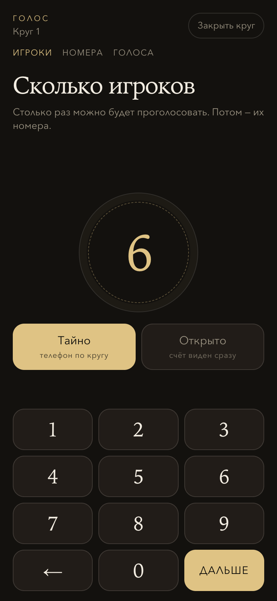
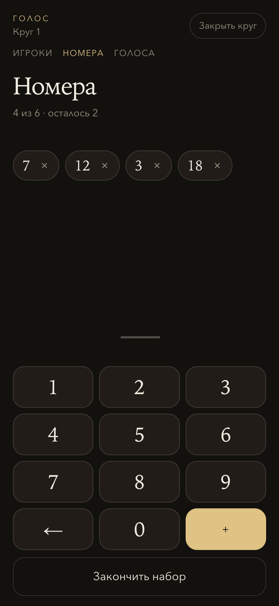
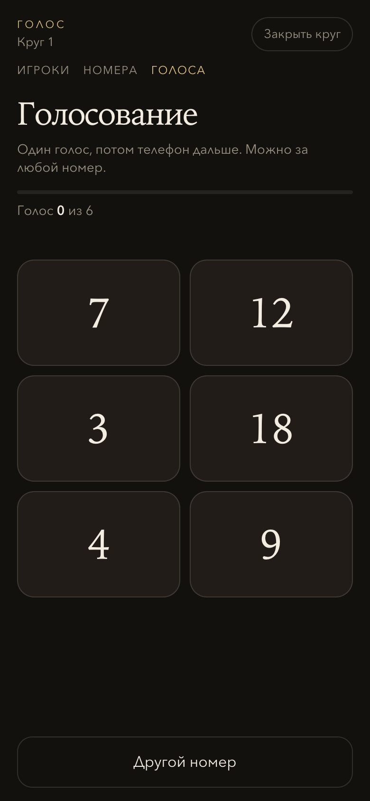
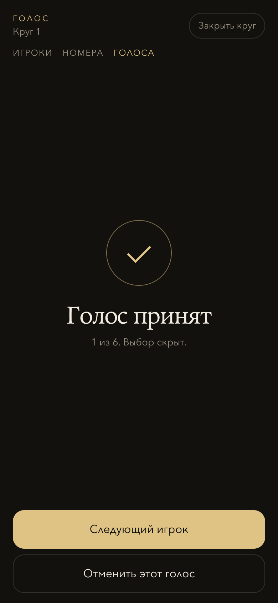
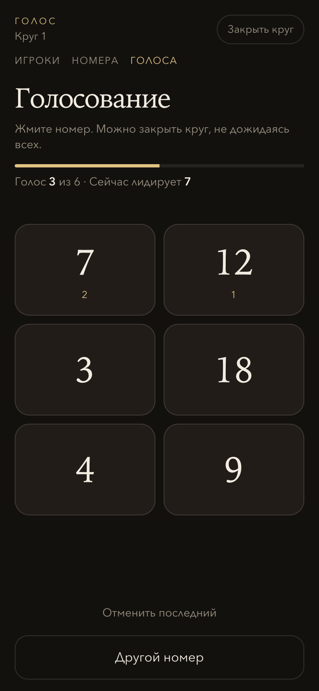
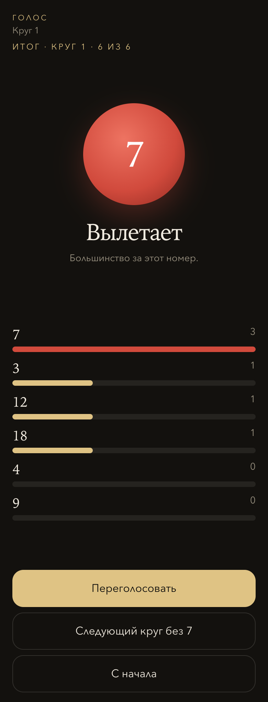

# Голосовалка

Телефон по кругу, когда надо кого-то выгнать из-за стола. Сначала число игроков, потом их номера, затем столько же голосов — за любой номер, даже если его не было в списке.

<table>
  <tr>
    <td align="center" width="230">
      
      <br><sub>Сколько игроков</sub>
    </td>
    <td align="center" width="230">
      
      <br><sub>Их номера</sub>
    </td>
    <td align="center" width="230">
      
      <br><sub>Голос</sub>
    </td>
  </tr>
  <tr>
    <td align="center" width="230">
      
      <br><sub>Выбор скрыт</sub>
    </td>
    <td align="center" width="230">
      
      <br><sub>Или счёт сразу</sub>
    </td>
    <td align="center" width="230">
      
      <br><sub>Кто вылетает</sub>
    </td>
  </tr>
</table>

## Круг

1. **Игроки.** Введите, сколько человек голосует. Столько голосов и будет в круге.
2. **Номера.** Наберите номера за столом. Лишний можно снять крестиком. Если часть ещё не сели — «Закончить набор» и идти дальше.
3. **Голоса.** Каждый жмёт номер. Можно проголосовать и за цифру, которой нет среди игроков.
4. **Итог.** Большинство вылетает. Ничья или пустой круг — никто не выбывает.

С итога можно переголосовать, продолжить недоигранный круг или начать следующий уже без выбывшего.

## Два способа считать

**Тайно.** Телефон идёт по кругу. После голоса экран гаснет: следующий видит только «голос принят», не чужой выбор.

**Открыто.** Счёт на плитках обновляется сразу, сверху написано, кто лидирует. Последний голос можно отменить.

## Закрыть раньше

На любом шаге до итога есть «Закрыть круг». Кнопка спрашивает ещё раз, чтобы не нажать её случайно. Если голосов не хватило, круг можно открыть обратно и доиграть.

## Запуск

Один файл, без сборки. Из папки проекта:

```bash
python3 -m http.server 8080 --bind 0.0.0.0
```

На этом компьютере — [http://localhost:8080](http://localhost:8080). С телефона в той же сети — `http://<ip-компьютера>:8080`.

Круг запоминается в браузере: можно свернуть телефон и вернуться к тому же шагу.
